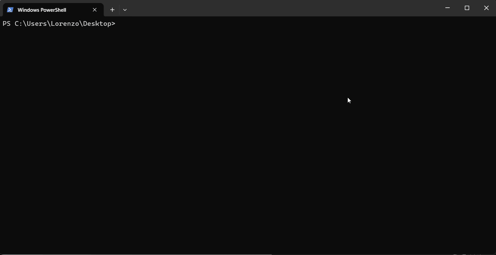

[](https://mseep.ai/app/lorenzosaraiva-mcpforge)

# MCPForge

Generate MCP servers from OpenAPI specs or docs pages, then verify generated request compatibility before you publish or install them.

[](https://www.npmjs.com/package/mcpforge)
[](./CHANGELOG.md)
[](https://opensource.org/licenses/MIT)

## Demo



## Why It Exists

Most OpenAPI-to-MCP generators stop at endpoint wrappers. That gets you a server, but not necessarily a toolset an LLM can use well. You often end up with hundreds of low-signal tools, weak descriptions, and no clear path from "API surface area" to "jobs a user wants done."

MCPForge does two extra things:

- Curates endpoint tools with AI so the public surface stays small and usable.
- Plans task-oriented workflow tools that wrap useful jobs like `find_customers`, `create_payment_link`, or `refund_payment`.

The result is closer to "brief the model on the jobs it can do" than "dump the entire REST spec into MCP."

## Quick Start

The 2.0 release candidate requires **Node 22.19+** (Node 24 LTS recommended). It adds managed connections for Cursor, Claude Desktop, and VS Code, read-only generation, runtime-bound verification, `doctor`, and `disconnect`. This source checkout contains the candidate; npm publication and external onboarding trials are separate release gates.

```bash
npm ci
npm run build
npm run dev -- connect ./openapi.yaml --client cursor --read-only
npm run dev -- doctor --dir ./mcp-server-example
```

See [the 2.0 guide](./docs/MCPFORGE-2.md) for client formats, diagnosis, migration, and removal, [first tasks](./docs/FIRST-TASKS.md) for GitHub and Stripe sandbox setup, and [the evaluation guide](./benchmarks/README.md) for reproducible task evidence.

Connect an API to the current Cursor project:

```bash
npx mcpforge connect ./openapi.yaml --client cursor
```

This generates a server, installs dependencies, builds it, verifies its tools against a local mock API, guides credential setup, and merges its entry into the project's `.cursor/mcp.json`.

Fastest path from the registry:

```bash
npx mcpforge add stripe
```

From an OpenAPI spec:

```bash
npx mcpforge init --optimize --workflows https://api.example.com/openapi.json
```

From a docs page when you do not have a spec:

```bash
npx mcpforge init --from-url --workflows https://docs.stripe.com/api
```

Preview without writing files:

```bash
npx mcpforge init --dry-run --optimize --workflows https://api.example.com/openapi.json
```

## Registry

Browse and install community-curated MCP servers:

```bash
mcpforge search                     # browse all servers
mcpforge search payments            # search by keyword or tag
mcpforge add stripe                 # generate Stripe MCP server instantly
mcpforge add stripe --pick          # generate and customize tools
```

Publish your optimized server:

```bash
mcpforge auth login                 # one-time GitHub login
mcpforge publish                    # publish from current project dir
mcpforge publish --slug my-api --tags payments,billing
```

## What MCPForge Does

- Parses OpenAPI 3.0, 3.1, and Swagger 2.0 specs from local files or URLs
- Scrapes docs pages and infers an API shape with Claude when no spec exists
- Curates raw endpoints into a smaller endpoint toolset with `--optimize`
- Plans task-oriented workflow tools with `--workflows`
- Generates a complete TypeScript MCP server with auth scaffolding and docs
- Preserves OpenAPI success-response schemas as MCP `outputSchema` and `structuredContent`
- Generates OAuth token handling for client credentials and refresh-token renewal
- Detects upstream spec drift and reports risk-scored breaking changes
- Verifies generated request compatibility over stdio with `mcpforge test`

## Feature Overview

- **Workflow planning** - Generates first-class workflow tools with deterministic step execution. Workflow tools depend on real upstream operations, so drift can be tracked during `diff` and `update`.
- **AI endpoint curation** (`--optimize`) - Uses Claude to cap noisy APIs to a smaller, better-described public surface. Strict mode defaults to <=25 tools. Standard mode allows broader coverage up to 80.
- **Docs URL inference** (`--from-url`) - Scrapes API docs pages and infers endpoints when there is no public OpenAPI spec.
- **Interactive selection** (`--pick`) - Lets you choose the exact public tools to expose after planning and optimization.
- **Breaking change detection** (`diff`) - Compares stored source IR against the latest upstream spec and reports high, medium, and low-risk changes.
- **Workflow-aware update flow** (`update`) - Rechecks upstream APIs, reports workflow impact, and regenerates in place.
- **Generated-server verification** (`test`) - Installs dependencies, builds the generated project, validates `listTools`, and verifies request construction against a local mock upstream before optional live calls.
- **Structured tool outputs** - Carries documented success-response schemas into MCP tool registration and returns machine-readable `structuredContent` alongside the text fallback. Generated workflows inherit the output contract when they return a complete endpoint result.
- **OAuth token lifecycle support** - OAuth-backed generated servers can use a static `ACCESS_TOKEN`, fetch client-credentials tokens, or renew access tokens from `OAUTH_REFRESH_TOKEN`.
- **Operation-specific security** - Preserves public overrides, alternative auth methods, combined schemes, and operation OAuth scopes instead of flattening security across the API.
- **Repo-level CI and tests** - The repo now includes Vitest coverage for workflow planning, generation, diffing, and selection logic, plus a GitHub Actions workflow.
- **Verification-aware publishing** (`publish`) - Public registry publishing now requires a successful verification run by default, and registry entries expose verification metadata to installers.

## Commands

| Command | What it does |
|---------|---------------|
| `mcpforge connect <spec-or-directory>` | Generate or resume a server, verify it, and configure Cursor. Supports `--dry-run`, `--project-dir`, `--name`, `--yes`, and `--skip-install`. |
| `mcpforge doctor` | Read-only project inspection; `--verify` explicitly installs/builds/launches and checks a local mock API. `--json` emits stable checks and exit codes without credential values. |
| `mcpforge disconnect --name <name>` | Remove only an unchanged managed client entry, preserving generated files and credentials. Supports the same client/scope/config options as `connect`. |
| `mcpforge add <slug>[@version] [output-dir]` | Install a server from the registry. Supports `--optimize`, `--workflows`, and `--pick`. |
| `mcpforge auth login` | Save a GitHub token for registry publishing. |
| `mcpforge auth logout` | Remove stored GitHub credentials. |
| `mcpforge auth status` | Show the stored GitHub login or `not logged in`. |
| `mcpforge search [query]` | Browse registry entries. Supports `--tags` and `--json`. |
| `mcpforge publish` | Publish the current project to the registry. Requires a fresh successful `mcpforge test` by default. Supports `--slug`, `--tags`, `--dir`, `--draft`, and `--allow-unverified`. |
| `mcpforge init <spec>` | Parse a spec or docs URL and generate a project. Use `--optimize`, `--workflows`, `--pick`, and `--dry-run` to control the pipeline. |
| `mcpforge generate` | Regenerate from `mcpforge.config.json`. Workflow mode, optimization mode, and tool selections are preserved in config. |
| `mcpforge inspect <spec>` | Inspect API structure and warnings. Use `--workflows` to preview the planned public toolset. |
| `mcpforge diff` | Compare the last stored source IR against the latest upstream version. Workflow-enabled projects also get workflow impact reporting. |
| `mcpforge update` | Refresh from upstream changes and regenerate in place. Supports `--workflows`, `--raw-endpoints`, `--pick`, `--optimize`, and `--force`. |
| `mcpforge test` | Rebuild a generated server, validate registered tools, and verify request compatibility against a local mock upstream. Use `--live` only when real credentials are configured. |

## Connect to Cursor

Run `connect` from the project where you want to use the tools. It previews the new client entry before asking to proceed. Other server entries, comments, and top-level settings are preserved; a conflicting server name requires a different `--name`. An existing configuration is backed up before replacement. Valid JSON and JSONC with comments/trailing commas are supported; malformed configuration is rejected without modification.

```bash
# Preview without generating, installing, building, or changing client settings
mcpforge connect ./openapi.yaml --client cursor --dry-run

# Generate curated workflow tools in a chosen directory
mcpforge connect ./openapi.yaml --optimize --workflows --output ./my-api-server

# Connect an existing generated project, including one created by mcpforge add
mcpforge connect ./my-api-server --project-dir ./my-cursor-project

# Non-interactive setup: fill credentials in the generated .env afterward
mcpforge connect ./openapi.yaml --yes --skip-credentials

# Resume without installing dependencies when they are already available
mcpforge connect ./my-api-server --skip-install
```

The command defaults to Cursor and project-level configuration, with a server name of `mcpforge-<api-name>`. Use `--name` for multiple connections to the same API. Reconnecting an identical entry is idempotent. Existing output folders are never regenerated by `connect`; pass the generated directory to resume or use `generate` to change its tools.

Credentials are entered with masked prompts and stored in the server's `.env`, which is added to its `.gitignore`. New credential files use owner-only permissions on POSIX; Windows uses the containing directory's ACLs. Existing `.env` files are not read or replaced. Cursor receives absolute Node, entrypoint, and dotenv paths so startup does not depend on its working directory. Credentials are not copied into client JSON. API keys, bearer tokens, basic `username:password`, and existing OAuth access tokens can be configured this way; browser OAuth login is not included. For OAuth renewal settings, edit `.env` using the generated `.env.example` and README.

Verification must pass before client settings are applied. It checks the stdio handshake, tool registration, and mock request compatibility; it does **not** validate real credentials or call the real API. Missing credentials can be filled later, but authenticated tools will need them before use. In non-interactive terminals, `--yes` is required to apply changes, and credentials are left for manual setup.

After setup, open the target project in Cursor and enable/reload the server in MCP settings. The command prints an example prompt using an actual generated tool. If tools are missing, reload the server or restart Cursor. If a real call returns 401/403, check `.env` and the API key's permissions. A failed build or verification leaves client settings unchanged and prints a command to resume.

## Workflow Mode

`--workflows` adds a planning layer on top of the parsed API:

- MCPForge starts from the parsed endpoint IR.
- If `--optimize` is enabled, it first curates which endpoints matter most.
- It then plans workflow tools around useful jobs and can keep a few curated endpoint fallbacks when needed.
- Each workflow stores which upstream operations it depends on, so future `diff` and `update` runs can report impact when those operations change.

Current workflow execution is intentionally deterministic:

- Linear steps only
- No arbitrary code generation
- Input mapping from workflow inputs and prior step results
- Output selection from saved step results

## AI Optimization

Use `--optimize` with `init` or `generate` to run Claude-based endpoint curation.

```bash
npx mcpforge init --optimize https://api.example.com/openapi.json
```

The optimizer:

- Curates to <=25 endpoint tools by default in strict mode
- Rewrites descriptions to be shorter and more LLM-friendly
- Removes admin, health, docs, and other low-value routes
- Prioritizes the endpoints most likely to matter for common user tasks

Use `--standard` for broader coverage or `--max-tools <n>` for a custom cap.

Requires `ANTHROPIC_API_KEY`. If it is missing, optimization is skipped and generation continues.

## Configuration

Generated projects include `mcpforge.config.json`. It stores:

- Spec source and source type
- Output directory
- Optimization settings
- Whether workflow planning is enabled
- Saved public tool selections
- Source IR, optimized IR, planned workflow IR, and final generated IR

That file is what makes `generate`, `diff`, and `update` work without repeating the original setup step.

## Testing Generated Servers

Run from inside a generated project:

```bash
npx mcpforge test
```

Or point at a generated project explicitly:

```bash
npx mcpforge test --dir ./mcp-server-my-api
```

By default, `mcpforge test`:

- runs `npm install` and `npm run build`
- starts the generated server over stdio
- verifies `listTools` matches `mcpforge.config.json`
- verifies registered input and output schemas match the generated IR
- starts a local mock upstream server and points `API_BASE_URL` at it
- calls each public tool with generated compatibility inputs
- verifies path, query, header, auth, OAuth token acquisition, and request-body construction for the supported matrix
- writes verification metadata back to `mcpforge.config.json`

Use `--live` only when the generated project's `.env` is configured and you want real upstream API calls.

Successful verification is what enables `mcpforge publish` by default.

## Compatibility Matrix

Current verified request compatibility covers:

- Auth: header API keys, query API keys, cookie API keys, bearer tokens, basic auth, OAuth client credentials, and OAuth refresh-token renewal
- Request bodies: `application/json`, `application/x-www-form-urlencoded`, `multipart/form-data`, text payloads, and binary-compatible payloads
- Responses: OpenAPI 3.x media-type schemas and Swagger 2.0 response schemas exposed as structured MCP output
- Verification path: local mock-upstream validation via `mcpforge test`

OAuth notes:

- Browser-based authorization-code login is not generated.
- For OAuth APIs, generated servers can use a ready-to-use `ACCESS_TOKEN`, client credentials via `OAUTH_TOKEN_URL`, `OAUTH_CLIENT_ID`, and `OAUTH_CLIENT_SECRET`, or refresh-token renewal via `OAUTH_REFRESH_TOKEN`.
- `mcpforge test` supplies a local mock OAuth token endpoint so generated request verification does not need live provider credentials.

## Tested Compatibility

MCPForge has been exercised against real-world specs across different formats and edge cases.

Spec compatibility and runtime verification are separate concerns:

- Spec compatibility: parse, inspect, generate, and compile against varied OpenAPI/Swagger inputs.
- Runtime verification: validate generated request construction against the supported auth/body matrix.

The registry is also the fastest place to find tested, optimized servers that were already run through MCPForge and published for reuse.

| API | Format | Endpoints | Status |
|-----|--------|-----------|--------|
| Twilio | OpenAPI 3.x | 197 | yes |
| Kubernetes | Swagger 2.0 | 1,085 | yes |
| Discord | OpenAPI 3.1 | 229 | yes |
| Notion | OpenAPI 3.0 | 13 | yes |
| PandaDoc | OpenAPI 3.0 | 115 | yes |
| Adyen | OpenAPI 3.1 | 2 | yes |
| Slack | YAML (OpenAPI 3.0) | 174 | yes |
| api.video | OpenAPI 3.0 (circular refs) | 47 | yes |
| Amadeus | Swagger 2.0 | 1 | yes |

Supports OpenAPI 3.0, 3.1, Swagger 2.0, JSON and YAML, circular `$ref`s, and specs with missing operation IDs. The broader compatibility report is in [examples/compatibility-report.md](./examples/compatibility-report.md).

An example verification output is in [examples/verification-report.md](./examples/verification-report.md).

## Contributing

The proposed next major milestone is verified API connections across clients, with diagnostics and measured task success. See [the roadmap](./ROADMAP.md) and [tracking issue #11](https://github.com/lorenzosaraiva/mcpforge/issues/11).

Contributions are welcome. Open an issue for bugs or ideas, or submit a focused PR. Registry contribution rules live in [registry/CONTRIBUTING.md](./registry/CONTRIBUTING.md).

## License

MIT
